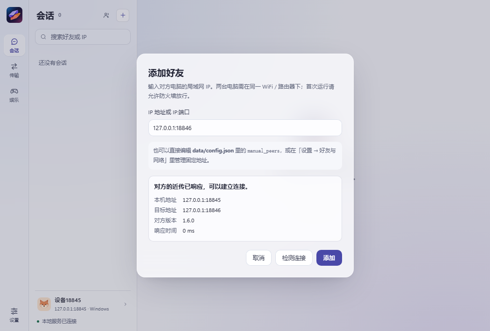
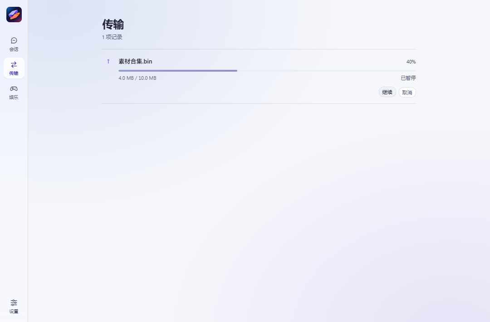

<p align="center"></p>

<h1 align="center">近传 · JinChuang</h1>

<p align="center">在同一个局域网里，直接聊天、发图、传文件。</p>

<p align="center">
  <a href="https://github.com/kiu9676-cmd/JinChuang/releases/latest/download/default.exe">下载 Windows 版</a> ·
  <a href="https://github.com/kiu9676-cmd/JinChuang/archive/refs/tags/v1.6.6.zip">下载 v1.6.6 源码</a> ·
  <a href="docs/SHOWCASE.md">功能图览</a> ·
  <a href="#快速开始">快速开始</a> ·
  <a href="docs/USAGE.md">使用手册</a> ·
  <a href="CHANGELOG.md">更新日志</a> ·
  <a href="LICENSE">MIT</a>
</p>

近传适合在可信的家庭或工作室网络里，把截图和文件从一台电脑发到另一台。不需要注册账号，消息和文件由设备直接交换，不经云端转发。Windows 可使用桌面窗口和托盘，也可以用浏览器连接本机运行的服务。


## 功能一览

<table>
  <tr>
    <td width="50%"><a href="docs/SHOWCASE.md#发送前检查附件"></a><br><b>发送前先检查附件</b><br>支持粘贴截图或拖入文件，确认后再发送。</td>
    <td width="50%"><a href="docs/SHOWCASE.md#搜索会话和筛选文件"></a><br><b>会话内快速找文件</b><br>按 Ctrl+F 搜索，筛选、定位或下载。</td>
  </tr>
  <tr>
    <td width="50%"><a href="docs/SHOWCASE.md#添加好友和连接诊断"></a><br><b>连不上，先检测</b><br>核对地址、版本和响应时间。</td>
    <td width="50%"><a href="docs/SHOWCASE.md#暂停继续和取消传输"></a><br><b>大文件可以暂停再继续</b><br>保留确认进度，传完用 SHA-256 校验。</td>
  </tr>
</table>

[查看完整功能图览：还有取消传输、头像设置、深色模式和四川麻将 →](docs/SHOWCASE.md)

双方使用 v1.6.6 或更新版本时，单聊文件和图片点「发送」后可[选择在线或离线发送](docs/USAGE.md#在线发送与离线发送)。在线先送邀请，等对方接收或选择另存位置；离线在发送端排队。两端同步显示传输进度和实时速度，保留暂停、继续、取消与校验。群文件和整目录沿用原有传输方式。

## 快速开始

**Windows 便携版**：从 [GitHub Release](https://github.com/kiu9676-cmd/JinChuang/releases/tag/v1.6.6) 下载 `default.exe`。从旧版升级时先退出托盘里的旧程序，新版放在原目录运行即可继续使用原有 `data/`。也可在旧版里通过「设置 → 更新」升级。

**从源码运行**：推荐使用 **Python 3.12**。在两台设备上各运行一份：

```bash
git clone https://github.com/kiu9676-cmd/JinChuang.git
cd JinChuang
python server.py
```

macOS / Linux 可用 `python3` 运行。浏览器默认打开 `http://127.0.0.1:8765`；如果没有自动打开，访问终端显示的本机地址。让两台设备连接同一网络，看到对方出现在会话列表后即可发送。看不到时，点「+」，输入对方在近传里显示的 IP（可带端口）。

### Windows 桌面模式

```powershell
py -3.12 -m pip install -r requirements-desktop.txt
py -3.12 desktop.py
```

桌面窗口使用 WebView2。首次启动遇到 Windows 防火墙提示时，只为可信的「专用网络」放行。想自行打包便携 EXE，可按[构建说明](CONTRIBUTING.md#构建-windows-exe)操作；更换目录前请保留原来的 `data/`。

## 网络与隐私

近传使用局域网 HTTP、WebSocket 和 UDP 发现，**不提供端到端加密**。不要在不可信的公共网络中传输敏感资料，也不要把服务端口转发到公网。SHA-256 检查文件是否完整，不等于加密或身份验证。客户端的更新检查会访问 GitHub。

## 开发

后端用 Python 标准库，前端是 HTML、CSS 和 JavaScript，无需先构建前端。桌面壳、传输和网页分别位于 `desktop.py`、`transfer_resume.py` 和 `web/`。

- [开发、测试与打包](CONTRIBUTING.md)
- [使用手册与故障排查](docs/USAGE.md)
- [安全问题报告](SECURITY.md)
- [素材及第三方许可说明](THIRD_PARTY_NOTICES.md)

## 许可

项目原创代码和文字文档采用 [MIT License](LICENSE)。内置的四川麻将保留其[独立许可声明](web/games/majiang/LICENSE)；其他素材、标识和外部依赖详见[许可说明](THIRD_PARTY_NOTICES.md)。
