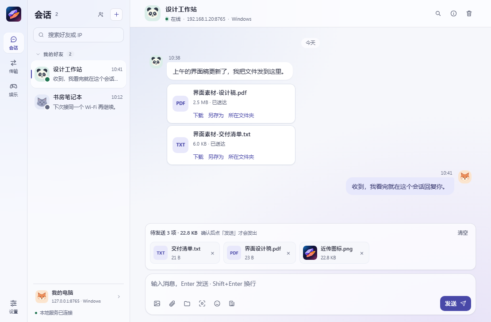
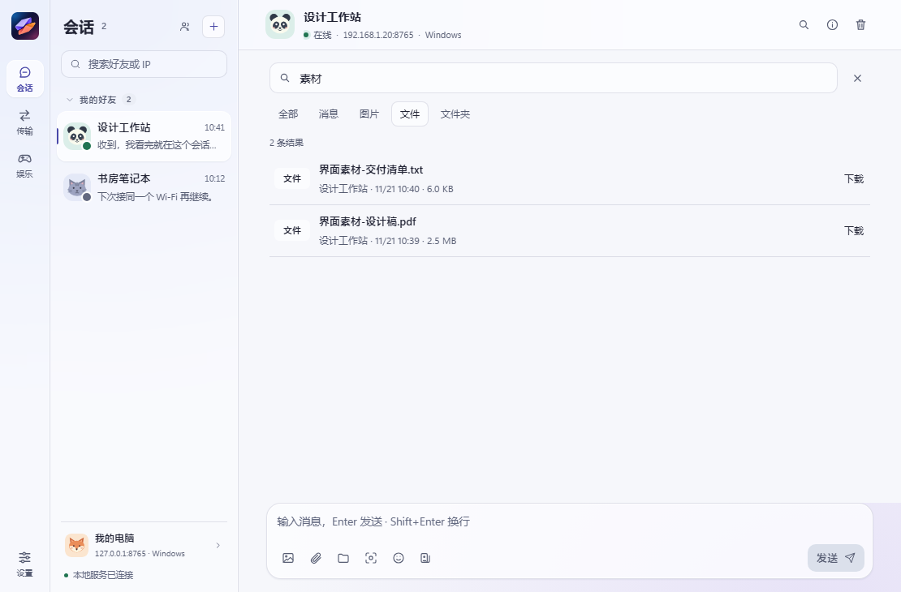
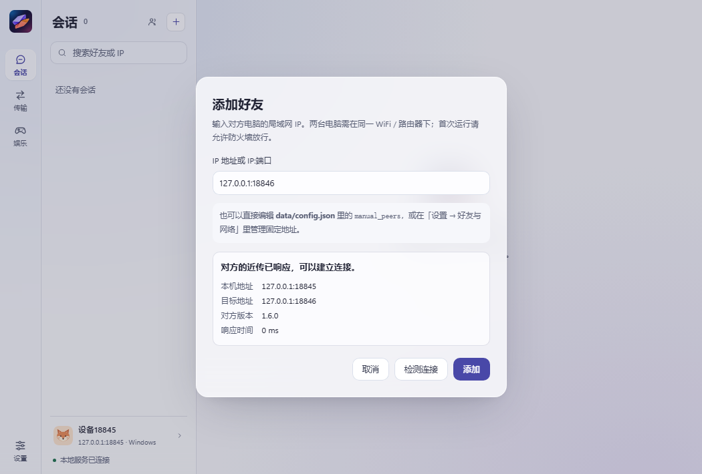
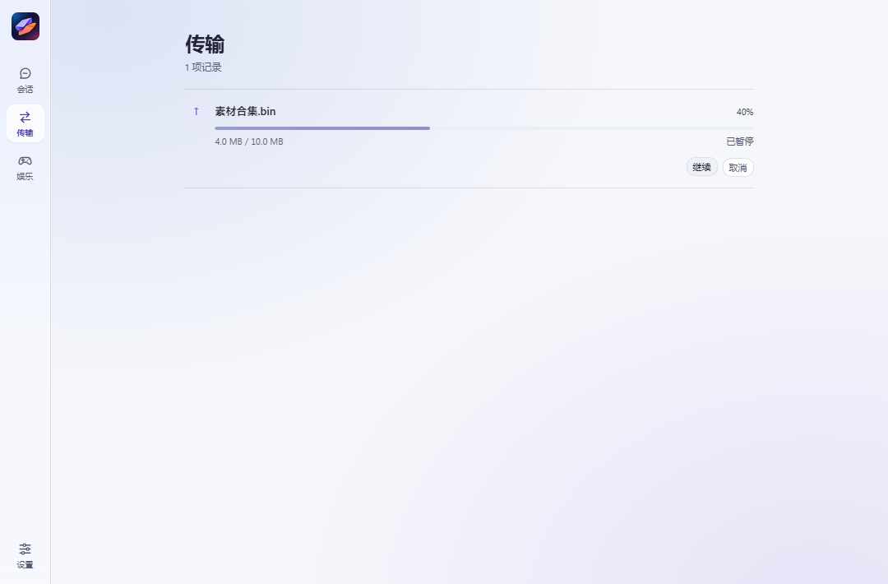
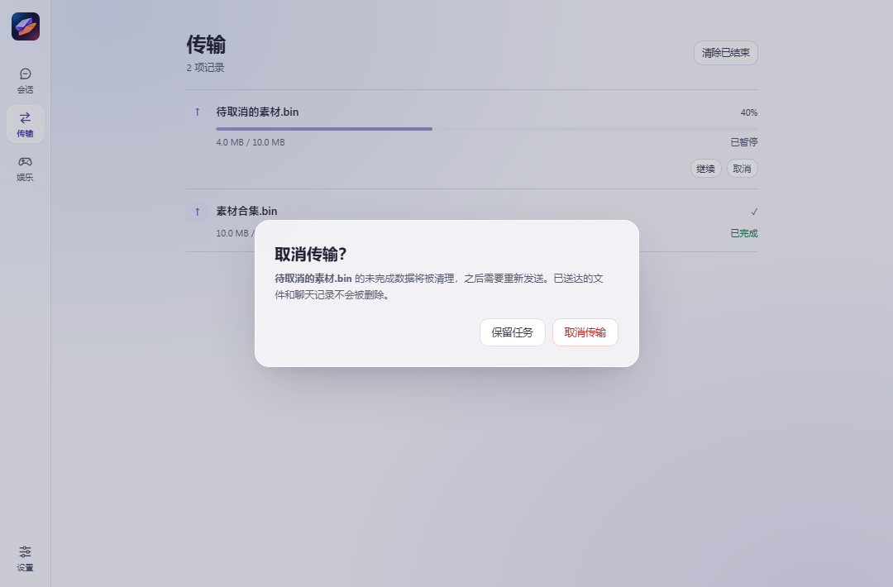
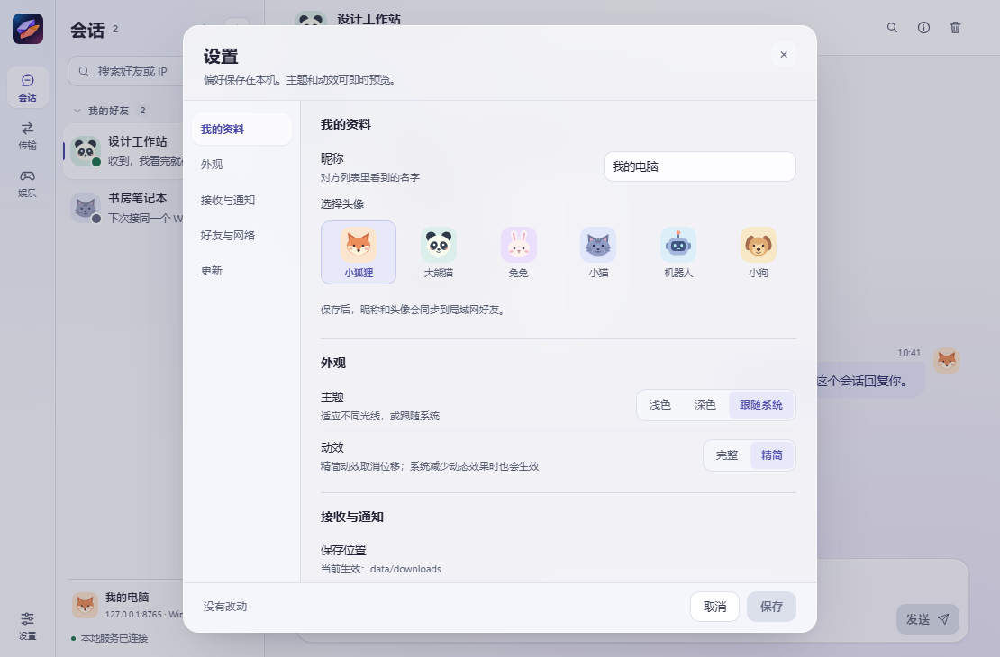
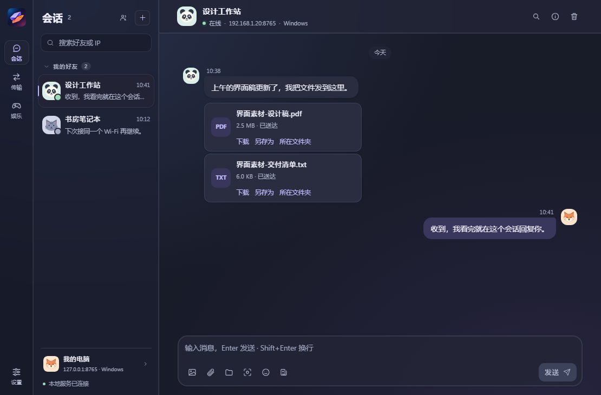
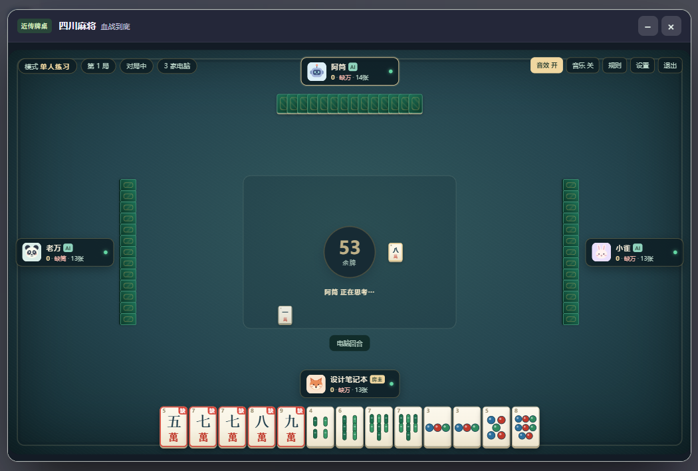

# 功能图览

[返回项目首页](../README.md) · [详细使用手册](USAGE.md)

用一台「设计工作站」和一台「我的电脑」演示日常互传。截图来自实际界面，设备、聊天和文件均为演示数据；部分为较早版本的功能回归截图。

[聊天](#聊天和收文件) · [附件草稿](#发送前检查附件) · [搜索](#搜索会话和筛选文件) · [连接诊断](#添加好友和连接诊断) · [传输控制](#暂停继续和取消传输) · [设置](#头像和外观) · [麻将](#四川麻将练习)

## 聊天和收文件

选中设备即可聊天。收到的文件直接显示在气泡里，可以下载、另存或打开所在文件夹。无需先切到独立的传输页。

## 发送前检查附件

把文件拖入会话，或从输入框下方选择图片、文件、文件夹。附件会先进入**待发送**区，能查看文件名、大小和图片缩略图；选错的可以移除，只有点「发送」才会传出。

## 搜索会话和筛选文件

在当前会话按 `Ctrl+F`（macOS：`⌘F`），或点右上角放大镜。输入「素材」并选「文件」，只看匹配的文件记录。可以直接下载，也可以点结果回到原消息。

## 添加好友和连接诊断

自动发现不到对方时，点会话列表旁的「+」，输入对方显示的 **IP 或 IP:端口**，先点「检测连接」。近传会显示检测结果、对方版本和响应时间。已添加的设备也可从「好友资料」运行诊断。

截图中的 `127.0.0.1` 和端口是本机双端测试用的。两台电脑互传时，请填写**对方电脑的局域网地址**。

## 暂停继续和取消传输

示例中的 10 MB 文件已经传了 **4 MB**。暂停会保留接收端确认的进度；点「继续」后从这里接着传。文件收齐后执行 SHA-256 校验。

取消前会提示将清理哪些数据。已送达的文件和聊天记录不会因此删除；对方暂不在线时，可等上线再重试清理。

> 完整传输控制需要双方都使用 v1.6.1 或更新版本，适用于单聊里的文件和图片。群文件和整目录仍走原有传输方式。

## 头像和外观

左下角「设置 → 我的资料」可更改昵称、选择内置头像。外观支持浅色、深色和跟随系统，也可精简页面动效。

同一个会话切到深色后的样子：

## 四川麻将练习

在「娱乐 → 四川麻将」可开始单人练习，与三家电脑一起打牌；也可以从会话邀请好友加入牌桌。

